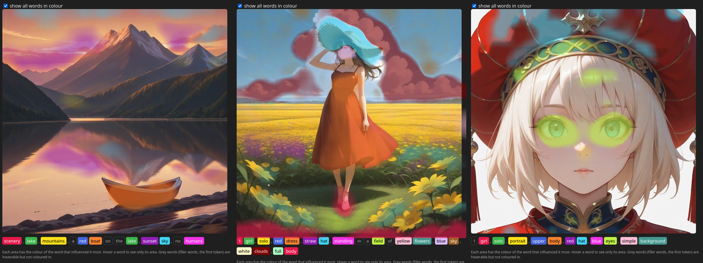
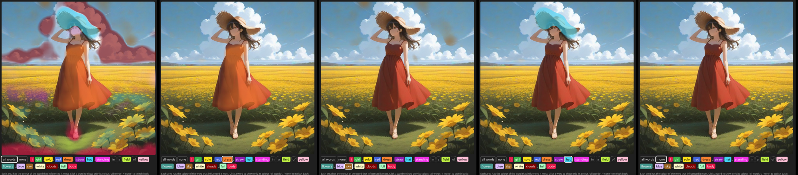
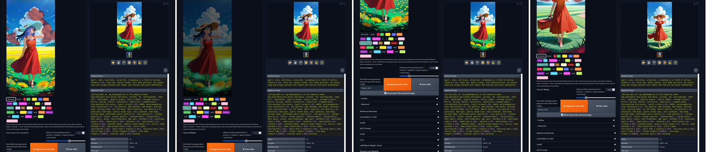
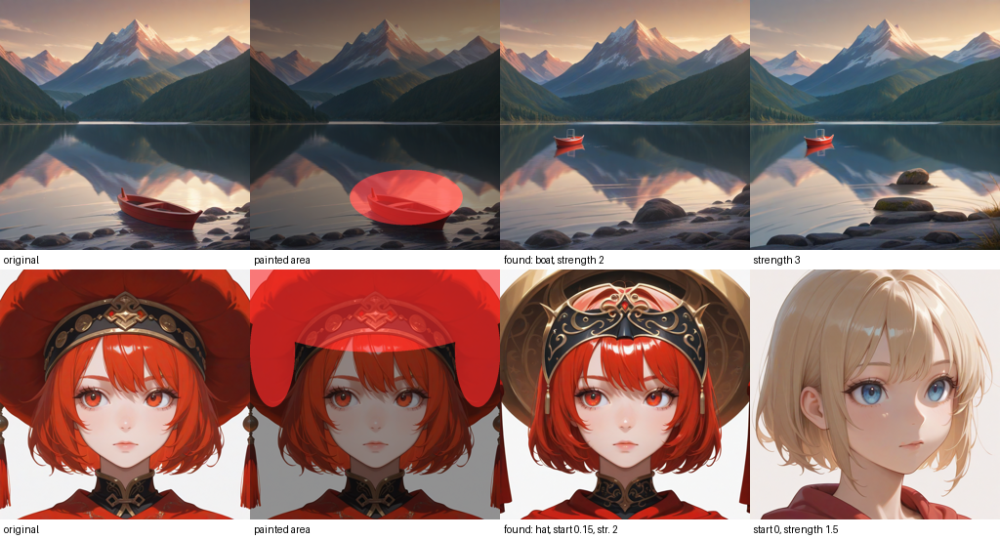
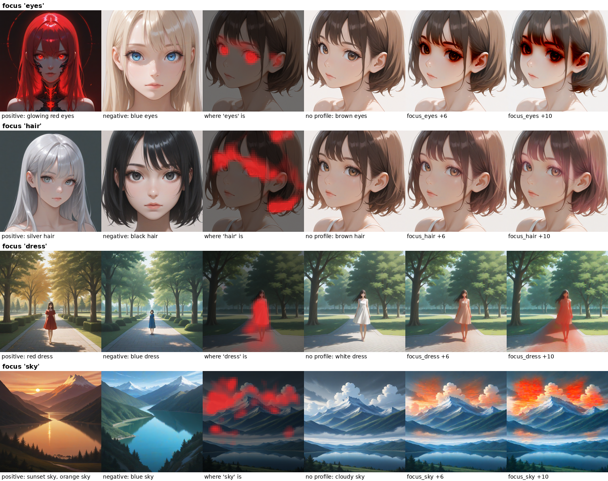
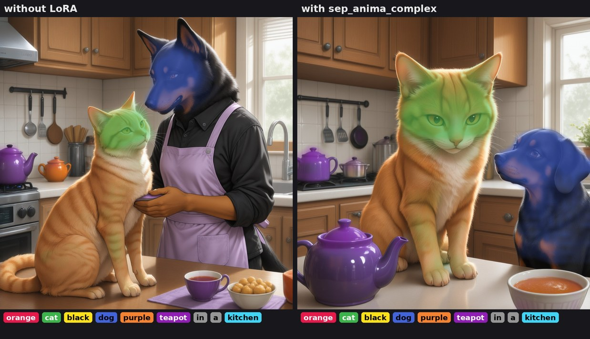
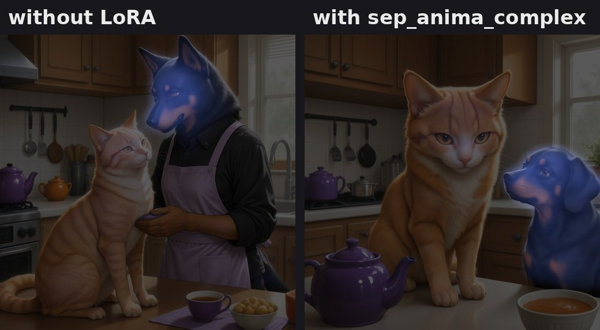
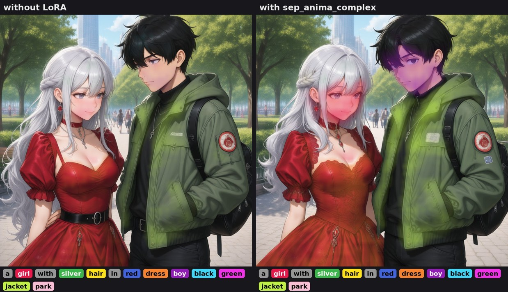
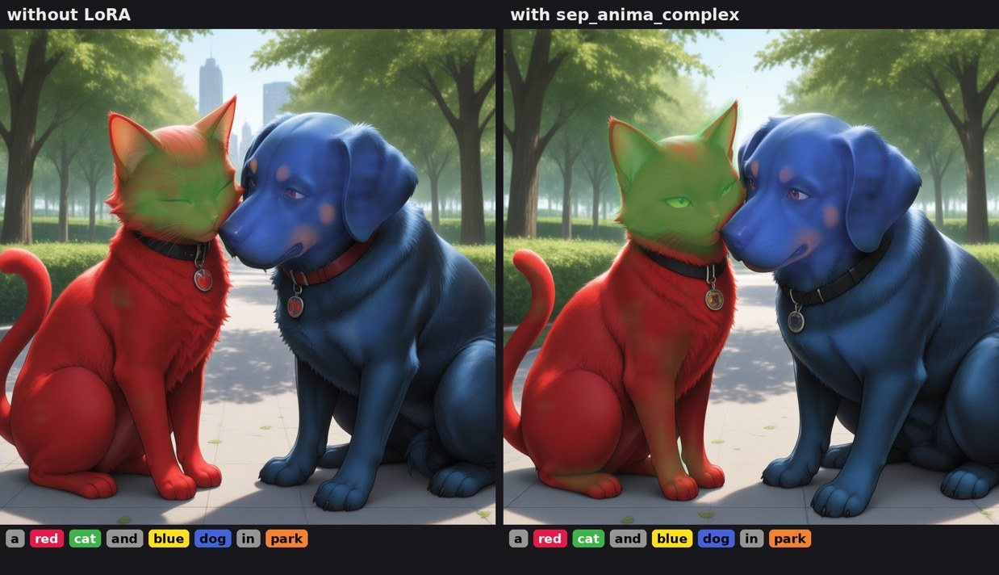

# Activation Steering

An extension for **Stable Diffusion WebUI Forge (neo)** and **A1111** that shows, for every word of the prompt,
where in the image it acts, and lets you change that: per word, per prompt, or for good with a trained LoRA.



*The word map after a generation: every area is tinted in the colour of the word that influenced it most.
Hover a word to see only its area; grey words are filler words.*

## Features

**Word map.** After each generation the prompt's words appear as coloured chips above the image. Click a word to
show only its area, or click into the image to find the words acting at that spot.



*"all words", then the single words "dress", "sky", "hat" and "none".*

**Word edits.** Give a word more or less influence (`hat:0, dress:2`) and regenerate with the same seed. Optimize
does it for you: it finds words fighting over the same area, weakens, rephrases or moves them, and can repeat
until the conflicts are gone (🔁 Auto optimize).



**Fix wrong areas** (Script dropdown). Paint over what shouldn't be there. The extension finds the words
responsible and weakens them only inside the painted area.



*Top: the boat is found and removed from the painted area. Bottom: the hat is found; it changes with strength 2
and disappears when the edit starts at step 0.*

**Profiles.** Record what an image switched on inside the UNet, merge liked (positive) and disliked (negative)
images into a profile, and apply it to new images with `<steer:name:strength>`, optionally only where certain
words are (`<steer:name:1:eyes>`).



**Also included:** rules (`allow hair ~ girl`, `keep straw hat`, `place sea -> background`), layers (move a word
to the background, the left side or onto another object), negative-prompt checks, a per-block analysis of which
LoRA causes an overlap, and learning from earlier optimisations.

## Separation LoRA

Trains a small LoRA (rank 4, about 3 MB) so that **nouns of different phrases take different areas by
themselves**: what the word edits do for one prompt, learned once. It only changes where words act (the
cross-attention query and key), not what they look like, so the style stays the same.



*"orange cat, black dog, purple teapot, in a kitchen", same seed. Without the LoRA, "dog" (blue) covers a head
on a person in a purple apron. With it, cat, dog and teapot each own an area.*



*Spotlight on the word "dog" in the same pair of images.*



*Two characters: with the LoRA, "girl" (red) and "boy" (purple) each light up on their own character; the picture
barely changes.*



*The blue dog's red collar (the cat's colour) becomes black.*

Train it in the accordion *Separation LoRA (train)*: choose the number of images and steps, press **Complex
templates** for multi-subject prompts (or write your own with `{person}`, `{animal}`, `{thing}`, `{colour}`,
`{pair}`, `{place}`), then **🎓 Train**. 48 images and 600 steps take about 9 minutes (Anima, 1024 px). Forge, SD 1.x / SDXL / Anima.

It fixes clear merges well, but on prompts unlike its training prompts the effect is small: it moves attention
apart, but it doesn't make the model draw an object it left out.

## Install

```
cd <webui>/extensions
git clone https://github.com/WifiLast/sd-webui-act-steer
```

Restart the webui; everything is in the *Activation Steering* section of txt2img / img2img.

- **Models:** SD 1.x and SDXL get every feature. Anima (Forge) gets the word map and the Separation LoRA.
- **MCP services (off by default):** image evaluation, rephrasing, ratings and the image history use external
  MCP servers. They are disabled unless `SD_ACT_STEER_MCP=1` is set (addresses: `SD_ACT_STEER_EVAL_URL`,
  `SD_ACT_STEER_REPHRASE_URL`); without them those steps are skipped.
- **Optional speed-up:** a fused Triton kernel for the word maps (`ACT_STEER_TOKEN_MAPS_SRC`); otherwise plain torch is used.

## API

| Endpoint | |
|---|---|
| `GET /actsteer/wordmap?tab=txt2img&image=0` | per word: colour, share, overlay; word overlaps; optimize plan |
| `POST /actsteer/train_separation` | `{"images", "steps", "rank", "keep", "prompts", "name"}` |
| `GET /actsteer/list`, `POST /actsteer/merge` | profiles |

More endpoints, all options and the details of every feature: **[docs/details.md](docs/details.md)**.
